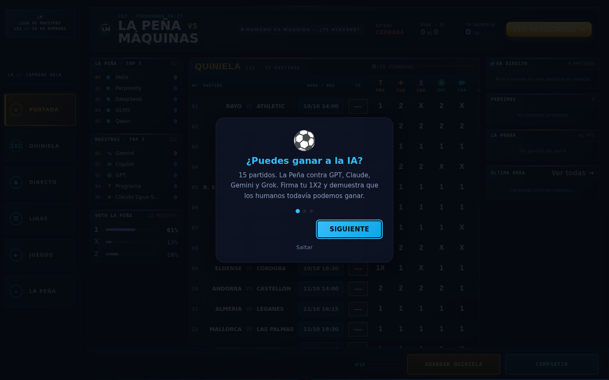
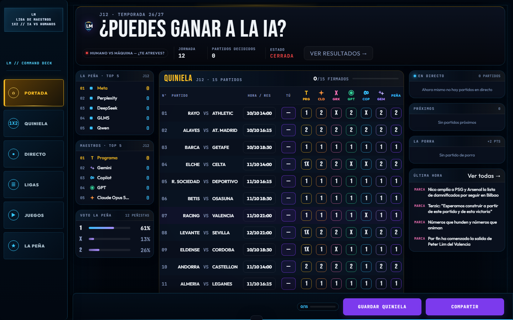
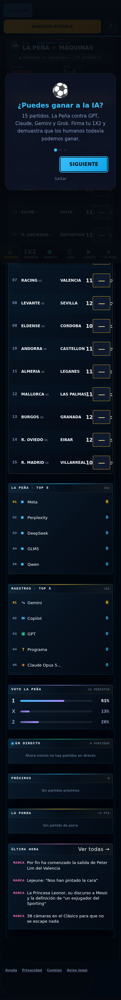
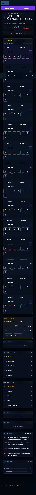

# Informe Fase 1 — Sala de Control 2099

**Fecha:** 2026-10-25
**Rama:** `redesign/futurista-2099`
**HEAD de partida:** `736f8e2`
**Alcance:** tokens globales y portada. Sin despliegue ni PR.

## Cambios

- `static/css/base/tokens.css`: actualizados `--bg-main`, `--bg-surface`, `--bg-card`, `--border-main` y radios; añadido `--brand-purple: #7c3aed`. No se cambiaron fuentes.
- `static/css/themes/future.css`: nueva capa visual de portada con paneles, tabla, ticker, KPIs, estados y adaptación móvil. El boleto presenta 14 partidos en tabla y el pleno en un panel dorado separado.
- `templates/liga_index.html`: añadida la capa `future` y preload de `future.css` después de `command_center.css`.
- `static/js/late_assets.js`: activa el preload de `future.css` como stylesheet al terminar el parseo para respetar el presupuesto de 25 hojas bloqueantes.
- `static/js/pages/cover_page.js`: titular cambiado únicamente en su string a «¿PUEDES GANAR A LA IA?». Los KPIs usan jornada, partidos finalizados con marcador y líder solo cuando hay puntuación positiva disponible; el estado/cuenta atrás aparece si la fecha o estado de cierre son válidos. El pleno se saca de la tabla y se representa en formato exacto `goles-goles`; cuando no hay un marcador exacto, se muestra `—`.
- `static/manifest.json`: regenerado por `python build.py` (42 entradas).
- `screenshots/fase1-despues/`: capturas regeneradas con movimiento reducido y onboarding cerrado. Desktop 1440×900 y móvil 390 px de ancho.

## Datos de portada y KPIs

En el payload usado para las capturas, la jornada disponible es J12, hay 0 partidos finalizados con marcador y la jornada figura cerrada. El KPI de líder se omite porque `ranking_maestros` no aporta ningún valor positivo de jornada; mostrar un nombre o una puntuación implicaría inventar un líder. El promedio Peña–IA se eliminó porque el payload no permite afirmar que haya una muestra válida para ambos grupos y los ceros de reserva no son resultados reales. El progreso individual se mantiene en la cabecera del boleto, donde describe el estado del boleto firmado, no un resultado de competición.

En el panel del pleno, los signos que no sean marcadores exactos de goles (por ejemplo `M-1`, `1`, `X` o `2`) se muestran como `—`; no se convierten en marcadores inventados. El resultado real, las predicciones de maestros, el consenso Peña y la selección propia usan el mismo filtro de formato.

## Verificación

- `python -m pytest -q --basetemp=<directorio temporal aislado>`: suite completa finalizada con código 0.
- `python -m pytest -q tests/test_portada.py`: 18 pruebas pasan.
- `ruff check .`: `All checks passed!`
- `ruff format --check .`: `185 files already formatted`
- `mypy liga_maestros`: `Success: no issues found in 74 source files`
- `python build.py`: terminó correctamente; manifiesto generado con 42 entradas.
- `git diff --check`: sin errores.
- Capturas Playwright: titular solicitado; 14 filas y un panel de pleno; `future.css` activo; onboarding cerrado; documento y body sin desbordamiento a 1440 y 390 px.

## Capturas

Las capturas «antes» son referencias de Fase 0. La captura móvil recorre la portada completa; la captura desktop conserva el encuadre de referencia 1440×900.

| Vista | Antes — Fase 0 | Después — Fase 1 |
|---|---|---|
| Desktop 1440×900 |  |  |
| Móvil 390 px |  |  |

## Desviaciones técnicas

1. `command_center.css` contiene reglas de portada fuera de capas, que prevalecen sobre las reglas normales dentro de `@layer future`. Para las colisiones puntuales, `future.css` conserva reglas sin capa acotadas a la portada; no se usó `!important`.
2. El límite del proyecto es de 25 hojas bloqueantes. `future.css` se declara como preload y el cargador existente lo activa tras el parseo; la prueba del presupuesto permanece en la suite.

La Fase 1 se entrega en `redesign/futurista-2099`, sin despliegue ni PR.
